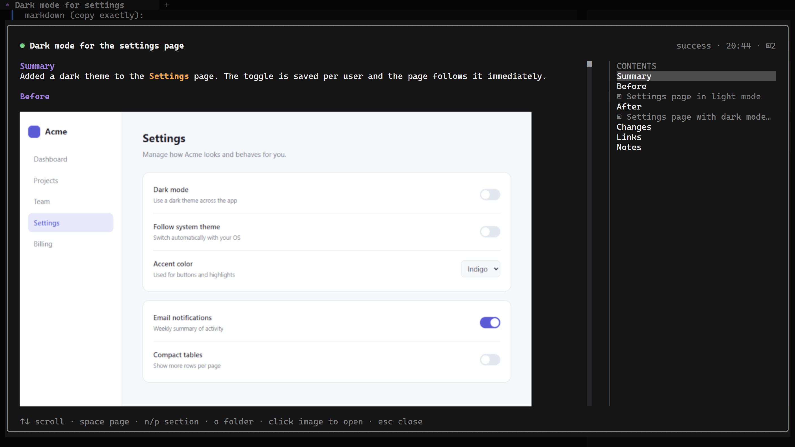
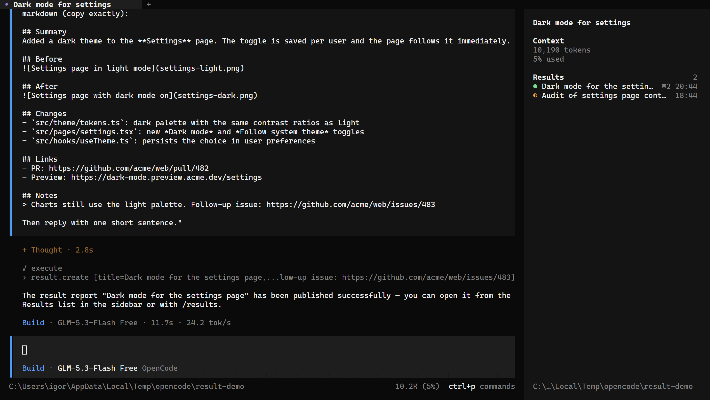
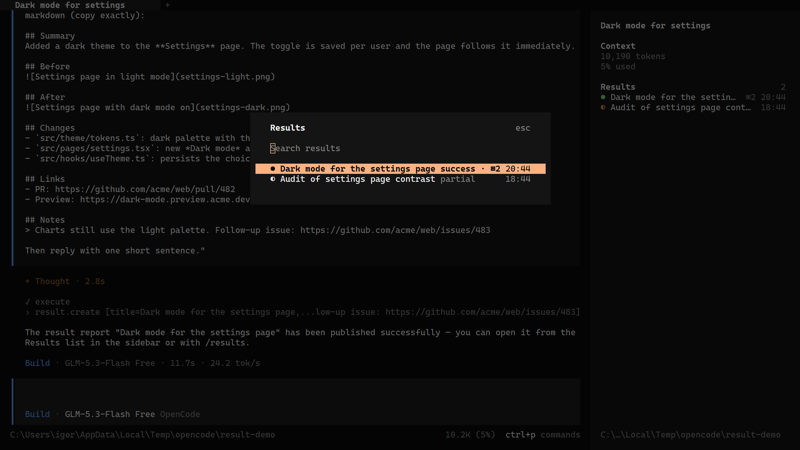
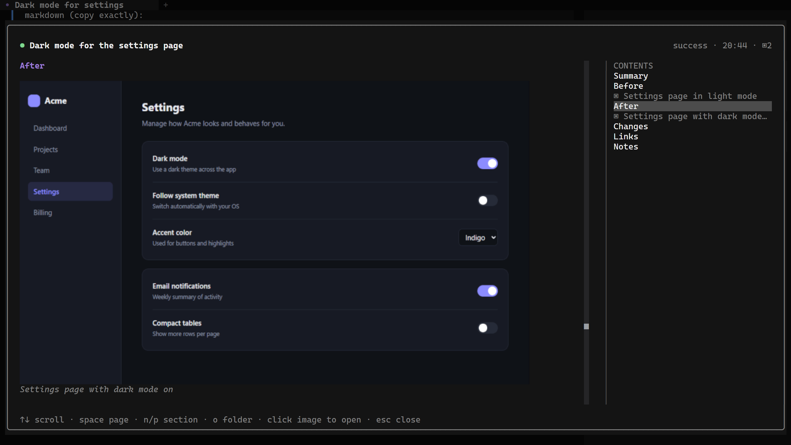

# opencode-result

A plugin for the [OpenCode](https://opencode.ai) TUI (v2) that lets the agent hand you a result report when it
finishes a task: a summary in markdown with links, notes and screenshots. Reports appear in the sidebar and open in a
large window right in the terminal, images included.

> Supports OpenCode V2 only (built against `@opencode/plugin` 2.2.0). V1 is not supported.

<p align="center">
  
</p>

## Features

- **Agent tools.** The agent publishes a report with `result_create` and adds to it later with `result_append`.
  A session can have several reports.
- **Real images in the terminal.** Screenshots are drawn with Kitty graphics or Sixel, and with colored blocks
  where neither works. An image that is partly scrolled out is cropped, so it stays sharp and never spills over the
  window.
- **Results in the sidebar.** Each report shows its status, image count and time. Click one to open it.
- **Large report window.** It takes nearly the whole terminal (up to 220 columns). The content is on the left and a
  clickable table of contents, with headings and images, is on the right.
- **`/results`** lists every report in the session, with search.
- **A toast** appears when the agent publishes a new report.
- **Reports stay.** They are saved in OpenCode's data directory, and every image is copied into the report, so
  temporary screenshots can be deleted.

<p align="center">
  
</p>

<p align="center">
  
</p>

## Requirements

- OpenCode V2 2.2.0 or newer.
- For sharp images, a terminal with Kitty graphics or Sixel: for example kitty, WezTerm, Ghostty, foot, iTerm2, or
  Windows Terminal 1.22+. Other terminals show images as colored blocks.

## Install

Install the plugin from GitHub with the OpenCode CLI:

```sh
opencode plugin add github:igorovh/opencode-result
```

To pin a release, add its tag:

```sh
opencode plugin add github:igorovh/opencode-result#v0.1.0
```

This adds the plugin to the global `plugins` array in `~/.config/opencode/opencode.jsonc`. Restart the TUI and a
`Results` section appears in the session sidebar once the agent publishes its first report.

You can also add the entry to the config yourself:

```jsonc
{
  "$schema": "https://opencode.ai/config.json",
  "plugins": ["github:igorovh/opencode-result"]
}
```

Update or remove it later:

```sh
opencode plugin update github:igorovh/opencode-result
opencode plugin remove github:igorovh/opencode-result
```

## Agent tools

| Tool | What it does |
|---|---|
| `result_create` | New report: `title`, `markdown`, optional `status` (`success`, `partial`, `failed`, `info`) |
| `result_append` | Adds markdown and images to an earlier report, or changes its title or status |
| `result_list` | Lists the reports in the current session |

Images use normal markdown, one per line: ``. A path can be absolute, relative to the session
directory, or a `file:`, `http(s):` or `data:` URL. PNG, JPEG, GIF and WebP are accepted. A missing or invalid image
fails the call with a clear error, so the agent can fix it.

You do not have to ask for a report. By default the plugin reminds the agent to publish one when it finishes a task
(see `remind` below).

## Keys and commands

| Where | Key | Action |
|---|---|---|
| Sidebar | click a report | Open it |
| Sidebar | click `Results` | Open the list |
| Anywhere | `/results`, or `Show results` in the palette | Open the list of the session's reports |
| Report | `↑` `↓` / `j` `k`, mouse wheel | Scroll |
| Report | `space` `b` / `PgDn` `PgUp` | Scroll a page |
| Report | `g` `G` / `Home` `End` | Top, bottom |
| Report | `n` `p` / `→` `←` | Next or previous section |
| Report | click an entry in the contents | Jump to it |
| Report | click an image | Open it in the system image viewer |
| Report | `o` | Open the report folder |
| Report | `esc`, `q`, click outside | Close |

`esc` takes you back where you came from: a report opened from the sidebar closes straight to the session, and a
report opened from `/results` goes back to the list.

<p align="center">
  
</p>

## Options

```jsonc
{
  "plugins": [
    {
      "package": "github:igorovh/opencode-result",
      "options": { "remind": true, "dir": "D:/reports" }
    }
  ]
}
```

- `remind` (default `true`): adds a short system instruction asking the agent to publish a report when it finishes
  a task. Set it to `false` to publish reports only when you ask.
- `dir`: where reports are stored. The default is `~/.local/share/opencode/result/`.

## How it works

- **Storage.** Each report is a folder `<dir>/<sessionID>/<reportID>/` with `report.json` and an `images/`
  folder. Reports from subagent sessions show up in their parent session too.
- **Server and TUI.** The server part registers the agent tools and an RPC service. The TUI reads reports through
  that RPC, so it also works when OpenCode runs on another machine: images are then sent over RPC.
- **Images.** They render with OpenTUI's `<image>`: Kitty graphics, then Sixel, then colored Unicode blocks. While you
  scroll, images use blocks, which move smoothly, and switch to full quality once scrolling stops. Force a protocol
  with `OPENTUI_IMAGE_PROTOCOL=kitty|sixel|blocks`.
- **The report window** is the plugin's own overlay rather than OpenCode's dialog, because the dialog is at most
  116 columns wide.

## Development

Requires [Bun](https://bun.sh).

```sh
git clone https://github.com/igorovh/opencode-result.git
cd opencode-result
bun install
bun test
bun run typecheck
```

To run your checkout instead of the published plugin, put its path in `plugins` and restart the TUI. After that,
OpenCode reloads the plugin whenever a file changes.

```jsonc
{
  "plugins": ["/path/to/opencode-result"]
}
```

## License

[MIT](LICENSE)
